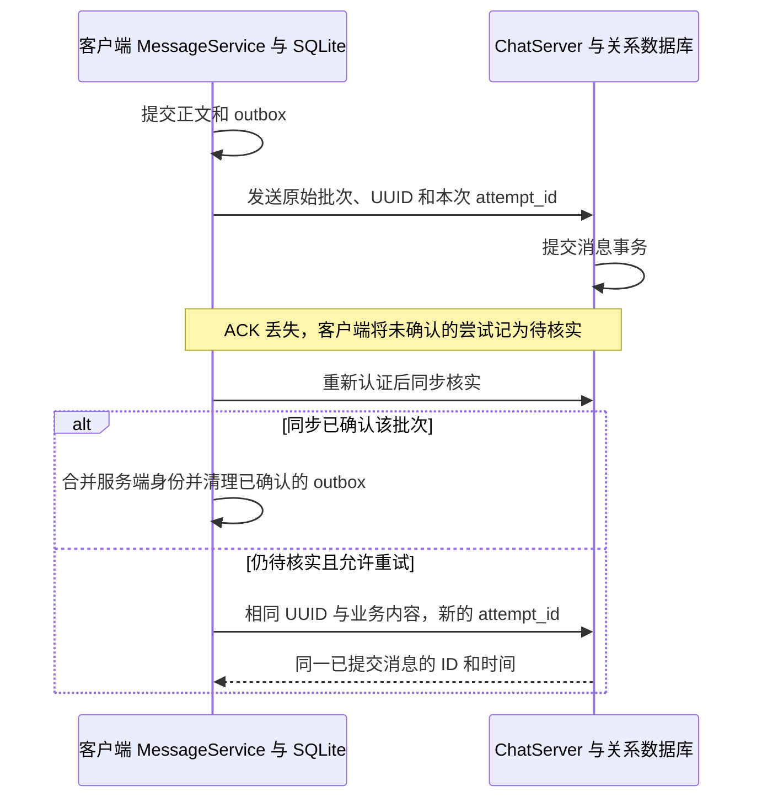

# 核心流程与状态机

沿一次操作查找状态的所有者、交接条件和对应回归。各节链接到生产实现和专项合同，实际运行过的版本与范围见[项目状态](Status.md)。

## 服务启动、选服与停机

| 要判断什么 | 谁决定，何时生效 | 验证入口 |
| --- | --- | --- |
| 这条 TCP 连接还能收发吗？ | `CServer` 持有连接，`CSession` 的 strand 串行处理 `Created → Active → Closing`。首次关闭原因生效。关闭后等在途 I/O 和绑定回调排空才释放所有权。 | [连接实现](../ChatServer/ChatServer/CSession.cpp) · [Session 回环测试](../tests/server/chat-session-state/README.md) |
| 新登录能选中这个实例吗？ | `InstanceLease` 用进程 owner 登记并续租。Gate 在配置的实例中读取有效租约和负载；注销须匹配 owner。TCP 的 `Ready()` 只描述本地监听状态。 | [CServer](../ChatServer/ChatServer/CServer.h) · [租约与凭据](Data.md#认证状态与恢复) · [Gate 路由测试](../tests/server/gate-request/README.md) |
| 何时可以关停依赖？ | 服务入口停止接收入站工作和续租，等待 TCP 停止、业务与会话清理排空，再注销实例、关闭依赖执行器与 I/O 池。一次请求仍可能在 Redis、数据库或出站 RPC 中执行。 | [服务入口](../ChatServer/ChatServer/ChatServer.cpp) · [并发合同](Concurrency.md) · [调度和排空测试](../tests/server/logic-dispatcher/README.md) |

## 登录、绑定与账号恢复

Gate 核验账号、选服并签发 Token。Qt 的 `ClientLoginFlow` 管理本次登录的等待、取消和总期限；`AuthFlowCoordinator` 按 `flowId` 推进 HTTP、TCP 和 Chat 登录阶段，TCP transport 用连接代次隔离旧连接事件。收到 Chat 登录成功后才建立账号会话。好友目录恢复及 outbox 恢复各有自己的条件。[登录适配器](../chat/clientloginflow.cpp) · [认证流程测试](../chat/tests/auth-flow/README.md) · [TCP 代次测试](../chat/tests/tcp-transport/README.md)

**绑定期间断线时，谁清理在线位置？**

1. 服务端校验登录凭据后，`SessionLifecycleCoordinator` 发起 Redis 发布。发布成功表示集群在线位置已更新，此时本机绑定仍可能失败。
2. `CSession::FinishBinding` 回到连接的 strand，检查连接仍然活跃且绑定未取消，再登记本机 UID 路由、设置认证身份并返回结果。
3. 本地绑定失败时协调器关闭连接，并按实例名和 Session ID 回滚匹配的位置。常规关闭也按身份注销本地及集群路由。跨实例替换还涉及发布时读到的前一会话；旧基线出现过延迟绑定影响另一有效会话的情况，当前版本待复验。[绑定与回滚](../ChatServer/ChatServer/SessionLifecycleCoordinator.cpp) · [连接提交点](../ChatServer/ChatServer/CSession.cpp) · [Session 测试 T09-SESSION-06～10](../tests/server/chat-session-state/README.md) · [历史复现及验收条件](plans/ChatServerThreadingFollowups.md)

`ClientSession` 管理已登录账号。暂时断线暂停发送、保留页面与草稿，并用原凭据有限重连。主动退出或切换账号等待 Gate 撤销成功后清理，撤销失败保留账号供重试。被踢或凭据被拒绝会停止自动重连。账号重置时，`UserMgr` 清理账号内存状态，`ClientSession` 释放会话页面。[账号会话](../chat/clientsession.cpp) · [重连与退出合同](Protocol.md#验证码用途与认证生命周期) · [账号重置测试](../chat/tests/session-reset/README.md)

## 草稿、消息提交与回执

`MessageSubmissionController` 按账号持有未落盘的草稿和附件。附件先上传得到描述符，再与正文一样交给 `MessageService`。其工作线程将消息和原始发送批次在账号 SQLite 的同一事务中写入；成功部分交给 outbox。保存中的取消等待本次保存结果，已落盘的部分仍由 outbox 负责。未落盘内容只在当前账号进程内可恢复。[提交控制器](../chat/messagesubmissioncontroller.cpp) · [存储合同](MessageStorage.md#工作流程) · [草稿与上传测试](../chat/tests/resource-transfer/README.md)

**服务端已提交，客户端丢失 ACK 时如何恢复？**

成功 ACK 或权威同步确认提交；接收端落盘和阅读有独立的回执。回执可先于正文到达，随后按身份关联。旧尝试的拒绝只影响匹配的在途尝试，迟到的较弱证据不能降低已确认的回执。私聊回执与群聊补拉分别维护。[状态归约](../chat/messagestate.h) · [私聊消息合同](MessageStates.md) · [SQLite 回执与重试测试 Q05-STORE-08～12](../chat/tests/message-storage/README.md) · [双库提交确认丢失测试](../tests/server/schema-migration/README.md#postgresql-与双库合同)

## 资源、下载与头像发布

客户端传输管理器分别跟踪当前上传、并发下载和头像请求。重建上传任务时用本地检查点查询服务端偏移；检查点失效则重新创建上传。下载先写临时文件，校验长度和摘要后才发布本地路径；取消或切换账号使旧回调失效。[传输实现](../chat/resourcetransfermanager.h) · [HTTP 续传和账号隔离测试](../chat/tests/resource-transfer/README.md)

服务端 `ResourceStore` 管理分块和已完成字节。上传完成提供资源 ID，消息事务提交后才产生聊天引用。发布头像还要验证图片并更新账号的当前头像；失败时保留原头像。消息的送达回执确认接收端保存了描述符，文件下载成功另由本地校验决定。[存储实现](../ResourceServer/ResourceServer/ResourceServer/ResourceStore.h) · [头像与资源合同](Resources.md) · [存储、权限及重启测试](../tests/server/resource/README.md)

## 好友、群成员与历史访问

| 操作 | 关系数据库中的判定 | 源码与覆盖 |
| --- | --- | --- |
| 删除好友后提交私聊 | 删除使关系失效并推进 revision。新增消息在提交事务内检查当前关系和请求版本；原 UUID 与已提交内容完全匹配时仍可返回原确认。已有历史和资源引用保留。 | [私聊写入资格](../common/message/PrivateSendAccess.h) · [好友合同](Protocol.md#基础资料与好友管理) · [消息同步测试](../tests/server/message-sync/README.md) |
| 退群、重入或解散后访问消息与附件 | 群成员变更与消息提交按群行锁排序。重新加入产生新的 membership epoch 和历史起点，读取按当前资格与加入边界判断。资源下载逐条检查可访问引用，另一条有效私聊引用仍可授予访问。 | [群成员事务](../common/message/GroupMembership.h) · [资源授权](../common/resource/ResourceCatalog.h) · [群资源合同](Resources.md#群资源权限) · [协议与权限测试](../tests/server/resource/README.md) |
